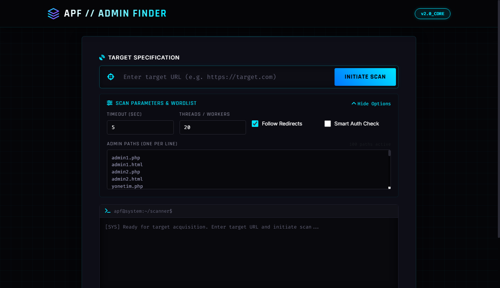
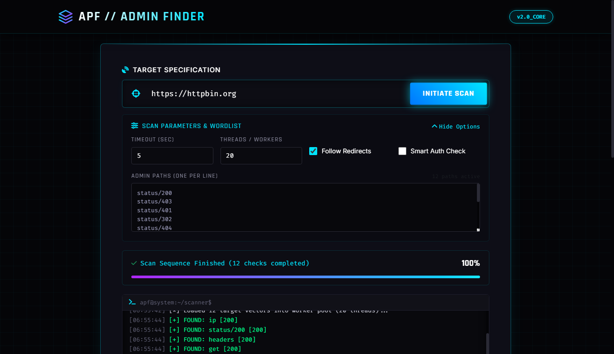

# APF // Admin Panel Finder

A multi-threaded web reconnaissance tool with a real-time cyberpunk telemetry dashboard designed to discover administrative endpoints, login portals, and hidden management interfaces.

## Features
- **Cyberpunk Telemetry Dashboard**: Real-time progress bar, live stat counters, and terminal log streaming.
- **High-Concurrency Scanner**: Thread pool architecture with adjustable worker count (5–100 threads).
- **Custom Wordlist Support**: Pre-loaded with comprehensive admin path dictionaries and live in-browser editor.
- **Smart Auth Check**: Keyword heuristic analysis to detect active login forms and authentication prompts.
- **Status Classification & Filtering**: Category tabs for 200 OK, 30x Redirects, and 401/403 Protected portals.

## Quick Start
```bash
python APF.py
```
*Automatically installs required dependencies (`flask`, `requests`) and launches the web dashboard at `http://127.0.0.1:5000`.*

<p align="center">
  
  
</p>

## Disclaimer
This tool is developed for security auditing and educational purposes only.
